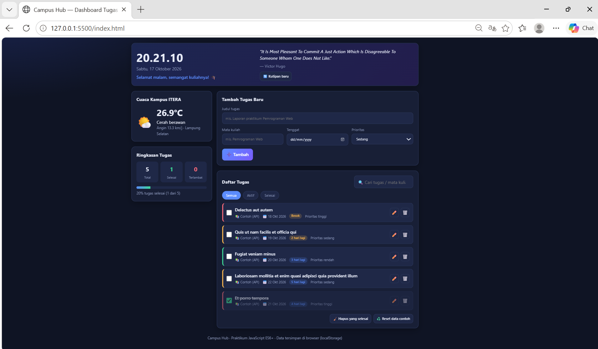
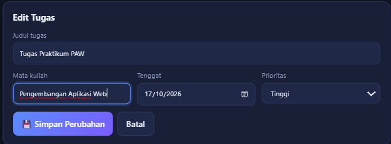
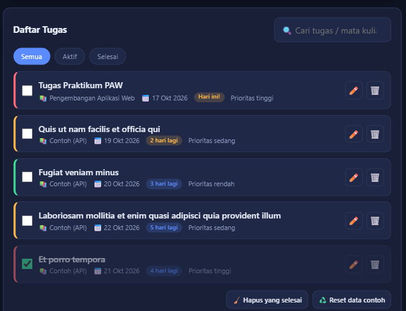

# 🎓 Campus Hub — Dashboard Tugas Mahasiswa

Aplikasi personal dashboard untuk membantu mahasiswa mengelola **tugas kuliah** sehari-hari. Selain daftar tugas, dashboard menampilkan **jam & sapaan**, **cuaca real-time kampus ITERA (Lampung Selatan)**, dan **kutipan motivasi harian** sehingga satu halaman cukup untuk memulai hari kuliah.

Praktikum JavaScript ES6+ — dibuat dengan HTML, CSS, dan JavaScript murni (tanpa framework, tanpa API key).

## Cara Menjalankan

1. Simpan `index.html`, `style.css`, dan `script.js` dalam satu folder.
2. Buka `index.html` di browser (atau gunakan ekstensi Live Server di VS Code).
3. Pastikan terhubung internet agar cuaca, kutipan, dan data contoh awal bisa dimuat.

## Fitur Aplikasi

| Fitur | Keterangan |
|---|---|
| **Tambah tugas** | Judul, mata kuliah, tenggat, dan prioritas (rendah/sedang/tinggi) |
| **Edit tugas** | Tombol ✏️ memuat data ke form, lalu simpan perubahan |
| **Hapus tugas** | Tombol 🗑️ per tugas, serta "Hapus yang selesai" sekaligus |
| **Tandai selesai** | Checkbox; tugas selesai dicoret dan turun ke bawah |
| **Filter & pencarian** | Semua / Aktif / Selesai, dan cari berdasarkan judul atau mata kuliah |
| **Penghitung tenggat** | Label otomatis: "Besok", "3 hari lagi", "Terlambat 2 hari" + penanda warna |
| **Ringkasan & progres** | Total, selesai, terlambat, dan progress bar persentase penyelesaian |
| **Cuaca ITERA** | Suhu, kondisi, dan kecepatan angin dari Open-Meteo |
| **Kutipan harian** | Kutipan acak dari DummyJSON, bisa diganti dengan tombol 🔄 |
| **Data contoh awal** | Pada kunjungan pertama, 5 tugas contoh diambil dari JSONPlaceholder |
| **Penyimpanan lokal** | Semua tugas tersimpan di `localStorage` dan tetap ada setelah browser ditutup |

## Screenshot


 


## Sumber API Publik (Gratis, Tanpa API Key)

| API | Endpoint | Dipakai untuk |
|---|---|---|
| Open-Meteo | `api.open-meteo.com/v1/forecast?latitude=-5.36&longitude=105.31&current_weather=true` | Widget cuaca kampus ITERA |
| DummyJSON Quotes | `dummyjson.com/quotes/random` | Kutipan harian di header |
| JSONPlaceholder | `jsonplaceholder.typicode.com/todos?_limit=5` | Data tugas awal sebelum disimpan ke localStorage |

## Daftar Fitur ES6+ yang Diimplementasikan (`script.js`)

### 1. `let` dan `const`
- `const` untuk nilai tetap: baris 9 (`STORAGE_KEY`), 11 (`API`), 17 (`WEATHER_CODES`), 38 (`PRIORITY_ORDER`), serta variabel lokal di hampir semua method (mis. baris 222, 242, 257).
- `let` untuk nilai yang berubah: baris 419 (`let percent`, dihitung ulang sesuai kondisi di `renderStats`).

### 2. Arrow Functions (lebih dari 3)
- Fungsi bantu: baris 41 (`escapeHTML`), 46 (`toDate`), 48 (`formatDate`), 51 (`generateId`), 53 (`toISODate`).
- Callback & event handler: baris 126 (`$`), 199, 206, 261 (`map`/`filter`), 286 (`tick`), 304, 317–320, 322, 327, 336 (event listener).

### 3. Template Literals
- Logika & teks: baris 46, 51, 95–98 (`deadlineLabel`), 102, 245–246, 294.
- Rendering HTML dinamis: baris 226–232 (widget cuaca), 389–404 (`renderTask`), 422–425 (kartu statistik), 428 (label progres).

### 4. Fungsi Asinkron (Async/Await + Promise)
- `async init()` — baris 155–167, memakai `Promise.allSettled` (baris 166) agar semua API dipanggil paralel.
- `async fetchWeather()` — baris 219–237 (`await fetch`, `await response.json()`).
- `async fetchQuote()` — baris 239–252.
- `async seedTasksFromAPI()` — baris 255–276.
- `async resetSampleData()` — baris 278–282.
- Penanganan error dengan `try/catch` di setiap pemanggilan fetch.

### 5. Classes
- `class TaskItem` — baris 61–109: constructor, getter (`daysLeft`, `isOverdue`, `deadlineLabel` baris 81–99), method `matches` (baris 101), dan `static fromJSON` (baris 106).
- `class DashboardApp` — baris 114–436: mengelola state, localStorage, fetch API, event, dan render.
- Private method `#cacheElements()` — baris 125.
- Getter `visibleTasks` — baris 373.

### 6. Destructuring
- Parameter fungsi: baris 62–70 (constructor `TaskItem`), 193 (`addTask`), 215, 261, 322, 327, 336.
- Objek & array bersarang: baris 224 (`current_weather: { ... }`), 225 (`[icon, label]`), 244, 302, 340, 351, 374, 386.

### 7. Spread Operator (state immutable)
- `{ ...this.state, ... }` — baris 174, 177, 187, 323, 330, 352, 365.
- `[task, ...this.state.tasks]` — baris 195 (tambah tugas).
- `{ ...task, ...changes }` — baris 200 (edit tugas).

### 8. Fitur ES6+ lainnya
- Default parameter: baris 41, 63–69.
- Nullish coalescing `??` — baris 225; optional chaining `?.` — baris 338.
- `Object.fromEntries` — baris 306.
- Method array fungsional (`map`, `filter`, `find`, `sort`, `forEach`) — baris 199, 206, 210, 373–382, 410.
- Property shorthand & computed object — baris 128–150.

## Pengelolaan Data (localStorage)

| Operasi | Method | Baris |
|---|---|---|
| Membaca | `loadFromStorage()` (dengan `try/catch` + `JSON.parse`) | 170–179 |
| Menyimpan | `saveToStorage()` (`JSON.stringify`) | 181–183 |
| Sinkronisasi state | `setTasks()` — update immutable → simpan → render | 186–190 |
| Create / Update / Delete | `addTask`, `updateTask`, `deleteTask`, `toggleTask`, `clearDone` | 193–216 |

Data disimpan dengan kunci `campus-hub:tasks:v1`. Data contoh dari API hanya diambil sekali, yaitu ketika `localStorage` masih kosong.

## Struktur Proyek

```
.
├── index.html      # struktur halaman
├── style.css       # tampilan (tema gelap, responsif)
├── script.js       # class TaskItem & DashboardApp
├── screenshots/    # screenshot untuk README
└── README.md
```
