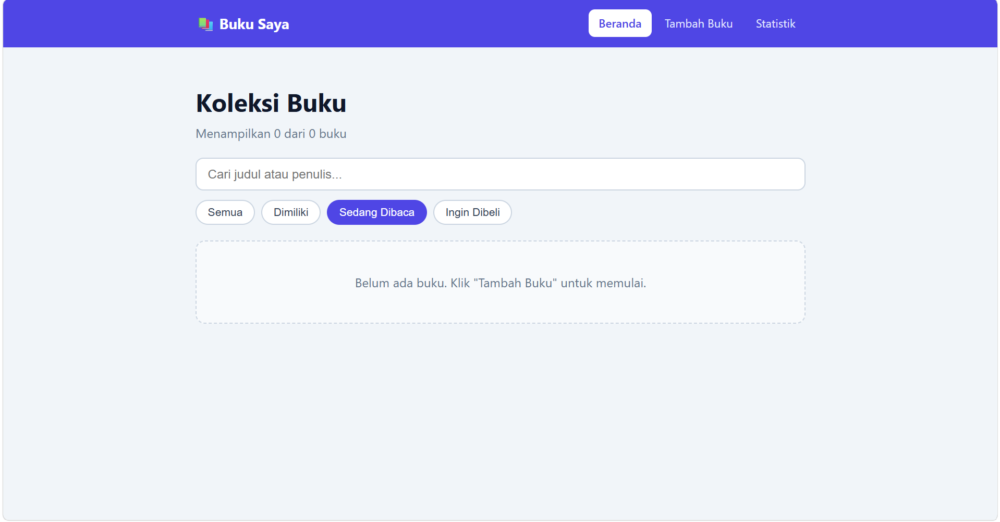
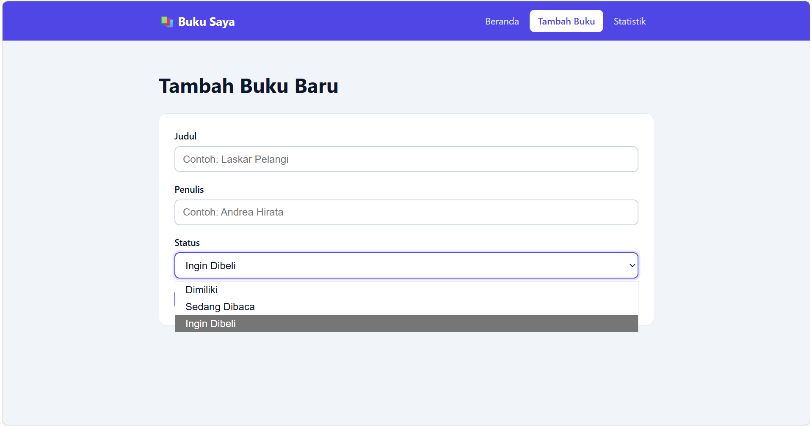
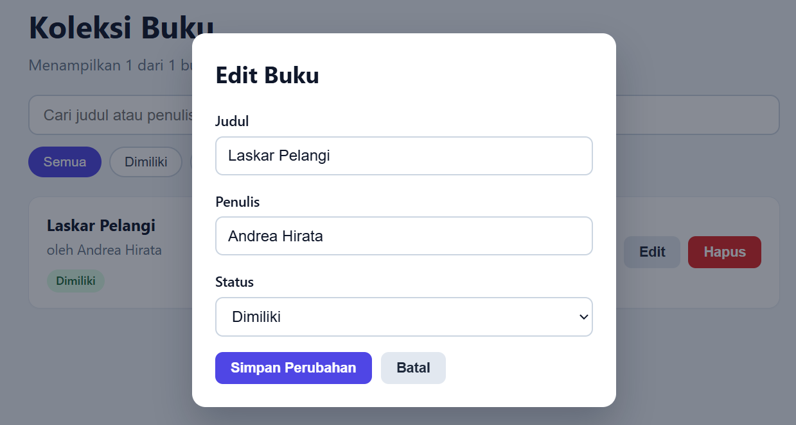
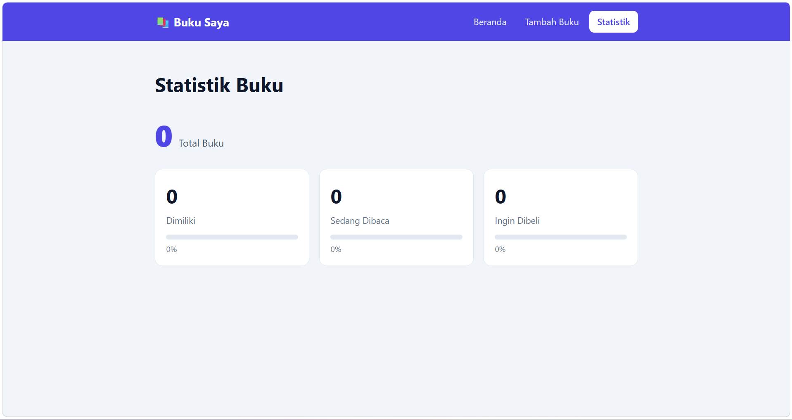

# 📚 Buku Saya — Aplikasi Manajemen Buku Pribadi

**Nama:** Arta Eka · **NIM:** 123140209 · **Tugas:** Pertemuan 3 (React)

## Deskripsi Aplikasi

Aplikasi web untuk mencatat koleksi buku pribadi. Setiap buku memiliki
**judul**, **penulis**, dan **status**:

| Status | Arti |
| --- | --- |
| `milik` | Buku yang sudah dimiliki |
| `baca` | Buku yang sedang dibaca |
| `beli` | Buku yang ingin dibeli |

### Fitur

- ➕ Menambah buku baru (judul, penulis, status)
- ✏️ Mengedit buku (form muncul dalam modal)
- 🗑️ Menghapus buku (dengan dialog konfirmasi)
- 🔎 Pencarian berdasarkan judul **atau** nama penulis (tidak peduli huruf besar/kecil)
- 🏷️ Filter berdasarkan status (Semua / Dimiliki / Sedang Dibaca / Ingin Dibeli)
- 📊 Halaman statistik (total buku, jumlah & persentase per status)
- 💾 Data tersimpan permanen di `localStorage` (tidak hilang saat refresh)
- ⚠️ Validasi form: kolom wajib diisi, dengan pesan error dan border merah

## Instalasi dan Cara Menjalankan

Prasyarat: **Node.js 18+** dan npm.

```bash
# 1. Masuk ke folder project
cd ArtaEka_123140209_Pertemuan3

# 2. Pasang dependensi
npm install

# 3. Jalankan mode development
npm run dev
# buka alamat yang tampil di terminal (biasanya http://localhost:5173)

# 4. Jalankan unit test
npm test

# 5. (opsional) Build produksi
npm run build
```

Project dibuat dengan perintah berikut:

```bash
npm create vite@latest ArtaEka_123140209_Pertemuan3 -- --template react
cd ArtaEka_123140209_Pertemuan3
npm install react-router-dom prop-types
npm install -D vitest @testing-library/react @testing-library/jest-dom jsdom
npm install -D @testing-library/user-event   # tambahan untuk simulasi klik/ketik
```

## Screenshot Antarmuka

| Halaman | Screenshot |
| --- | --- |
| Beranda (daftar, filter, pencarian) |  |
| Tambah Buku (dengan error validasi) |  |
| Edit Buku (modal) |  |
| Statistik |  |

## Struktur Folder

```
src/
├── components/
│   ├── BookForm/     BookForm.jsx + .css   (form tambah & edit + validasi)
│   ├── BookItem/     BookItem.jsx + .css   (kartu satu buku)
│   ├── BookList/     BookList.jsx + .css   (daftar buku / pesan kosong)
│   ├── BookFilter/   BookFilter.jsx + .css (pencarian + filter status)
│   └── Navbar/       Navbar.jsx + .css     (navigasi)
├── pages/
│   ├── Home/         Beranda
│   ├── AddBook/      Tambah buku
│   └── Stats/        Statistik
├── hooks/
│   ├── useLocalStorage.js
│   └── useBookStats.js
├── context/
│   └── BookContext.jsx
├── __tests__/        Unit test (Vitest + React Testing Library)
├── App.jsx           Routing + Provider
└── main.jsx
```

## Penjelasan Fitur React yang Digunakan

### 1. Functional Components + Hooks
Seluruh komponen berupa function component.

- **`useState`** — state lokal: nilai form & error (`BookForm`), buku yang sedang
  diedit/dihapus (`Home`), filter dan kata kunci pencarian (`BookContext`).
- **`useEffect`** — menyimpan data ke `localStorage` setiap data berubah
  (`useLocalStorage`).
- **`useMemo` / `useCallback`** — menghitung statistik dan hasil filter hanya saat
  data berubah (`useBookStats`, `BookContext`).

### 2. Context API (`BookContext.jsx`)
`BookProvider` menyimpan state global (daftar buku, filter, pencarian, statistik)
dan aksi `addBook`, `updateBook`, `deleteBook`. Komponen mana pun mengaksesnya
dengan hook `useBooks()` sehingga tidak perlu *props drilling*.

### 3. React Router (`App.jsx`)
Navigasi multi-halaman memakai `BrowserRouter`, `Routes`, `Route`, `NavLink`,
dan `Navigate`:

| Path | Halaman |
| --- | --- |
| `/` | Beranda |
| `/tambah` | Tambah Buku |
| `/statistik` | Statistik |
| `*` | Dialihkan ke `/` |

### 4. Custom Hooks (`src/hooks/`)
- **`useLocalStorage(key, initialValue)`** — seperti `useState` tetapi tersinkron
  ke `localStorage`, dengan `try/catch` jika JSON rusak.
- **`useBookStats(books)`** — menghitung total, jumlah, dan persentase per status.

### 5. Komponen Reusable
`BookForm` (dipakai untuk tambah **dan** edit), `BookItem`, `BookList`,
`BookFilter`, dan `Navbar`.

### 6. PropTypes
Semua komponen yang menerima props memakai `PropTypes` (`BookForm`, `BookItem`,
`BookList`, `BookFilter`, `BookProvider`).

### 7. Error Handling Form
Fungsi `validateBook()` memeriksa judul, penulis, dan status. Jika tidak valid:
pesan error merah muncul di bawah kolom, border input berubah merah, dan data
**tidak** disimpan. Setelah submit pertama, validasi berjalan live saat mengetik.

## Laporan Testing

Framework: **Vitest + React Testing Library** (14 test, semuanya lulus).

| # | Test | Yang diuji |
| --- | --- | --- |
| 1–2 | `useLocalStorage` | nilai awal; simpan & baca ulang setelah "refresh" |
| 3–4 | `useBookStats` | hitungan per status; daftar kosong |
| 5–6 | `validateBook` | input kosong → error; input valid → tanpa error |
| 7–8 | `BookForm` | pesan error + border merah + tidak submit; submit valid |
| 9 | Aplikasi | menampilkan data dari localStorage |
| 10 | Aplikasi | filter status |
| 11 | Aplikasi | pencarian judul atau penulis |
| 12 | Aplikasi | hapus buku dengan konfirmasi |
| 13 | Aplikasi | edit buku |
| 14 | Aplikasi | tambah buku lewat halaman tambah → muncul di statistik |

## Teknologi

React 19 · Vite · React Router · PropTypes · Vitest · React Testing Library · localStorage
