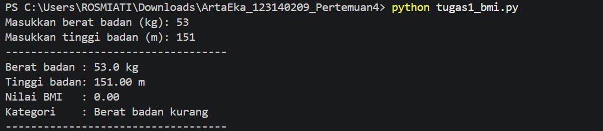
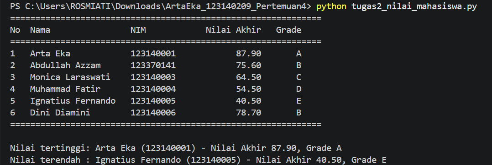
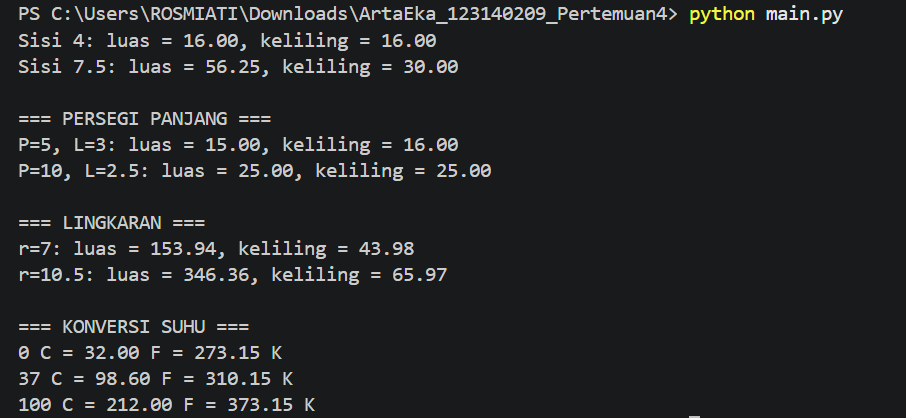

# Tugas Praktikum Dasar Pemrograman Python (Pertemuan 4)

## Identitas
- **Nama**: Arta Eka Yuly Rajagukguk
- **NIM**: 123140209

## Deskripsi Program

### 1. `tugas1_bmi.py`
Meminta berat (kg) dan tinggi (m), menghitung `BMI = berat / (tinggi * tinggi)` melalui fungsi `hitung_bmi()`, lalu `tentukan_kategori()` memakai if-elif-else (kurang, normal, berlebih, obesitas). Hasil dicetak dengan 2 angka desimal.

### 2. `tugas2_nilai_mahasiswa.py`
Menyimpan list berisi dictionary mahasiswa (nama, nim, nilai_uts, nilai_uas, nilai_tugas). Nilai akhir = 30% UTS + 40% UAS + 30% Tugas, grade A-E ditentukan oleh `tentukan_grade()`. Data ditampilkan dalam tabel, lalu dicari mahasiswa dengan nilai tertinggi dan terendah.

### 3. `math_operations.py` dan `main.py`
`math_operations.py` berisi konstanta `PI`, fungsi luas dan keliling (persegi, persegi panjang, lingkaran), serta konversi suhu (Celsius ke Fahrenheit dan Kelvin). `main.py` mengimpor modul dengan dua cara (`import math_operations` dan `from math_operations import ...`) dan menguji semua fungsi.

## Cara Menjalankan (VS Code Terminal)
```bash
python tugas1_bmi.py
python tugas2_nilai_mahasiswa.py
python main.py
```

## Screenshot Hasil Eksekusi
- Soal 1: 
- Soal 2: 
- Soal 3: 
