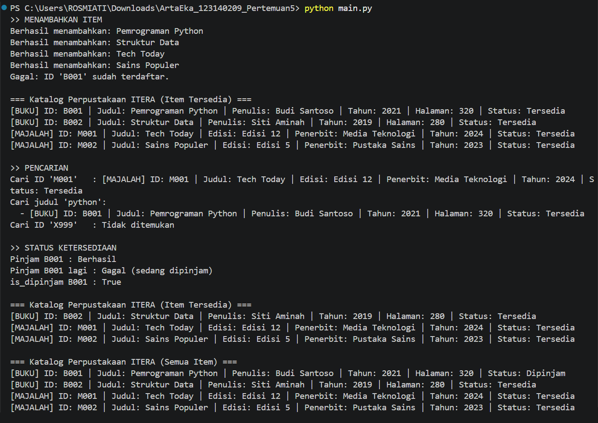

# Sistem Manajemen Perpustakaan Sederhana

## Identitas Mahasiswa
- **Nama Lengkap** : Arta Eka Yuly Rajagukguk
- **NIM**          : 123140209
- **Kelas Praktikum** : RB

## Deskripsi Program
Program ini mengelola koleksi perpustakaan berupa buku dan majalah.

**Alur program** (`main.py`):
1. Membuat objek `Library`, lalu menambahkan beberapa `Book` dan `Magazine` (ID duplikat ditolak).
2. Menampilkan katalog item yang tersedia.
3. Mencari item berdasarkan ID dan berdasarkan judul (kata kunci, tidak peka huruf besar/kecil).
4. Meminjam item, lalu menampilkan katalog lagi untuk menunjukkan status ketersediaan berubah.
5. Mendemonstrasikan `hitung_denda()` pada Book dan Magazine.

**Penerapan 4 pilar OOP:**
| Pilar | Penerapan |
|---|---|
| **Class** | `LibraryItem`, `Book`, `Magazine`, dan `Library` masing-masing punya atribut dan method sendiri. |
| **Inheritance** | `Book` dan `Magazine` mewarisi `LibraryItem` dan memakai `super().__init__()`, `pinjam()`, `kembalikan()`. |
| **Encapsulation** | `__dipinjam` (private) di `LibraryItem` dan `__koleksi` (private) di `Library`; atribut `_item_id`, `_judul`, dll. protected. Data diubah hanya lewat method. `@property` dipakai untuk `item_id`, `judul`, dan `is_dipinjam` (read-only). |
| **Polymorphism** | `get_detail()` dan `hitung_denda()` adalah abstract method yang di-override berbeda di `Book` (Rp1.000/hari) dan `Magazine` (Rp500/hari). `Library` memanggilnya tanpa peduli jenis item. |

**Struktur berkas:**
```
library_item.py   # LibraryItem (ABC), Book, Magazine
library.py        # Library
main.py           # skrip pengujian
```

## Panduan Menjalankan Program
Pastikan Python 3 terpasang, lalu jalankan dari folder proyek:
```bash
python main.py
```

## Screenshot Output
> Jalankan `python main.py`


